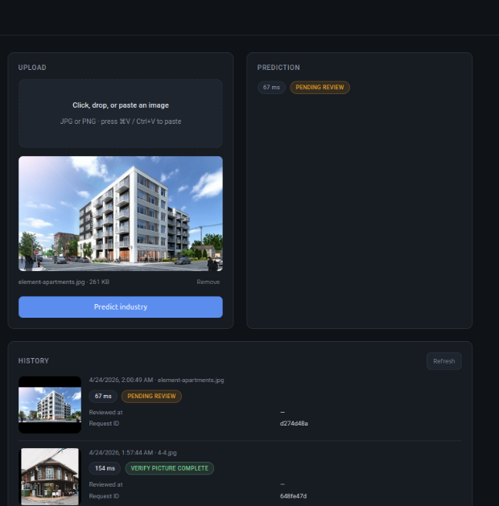
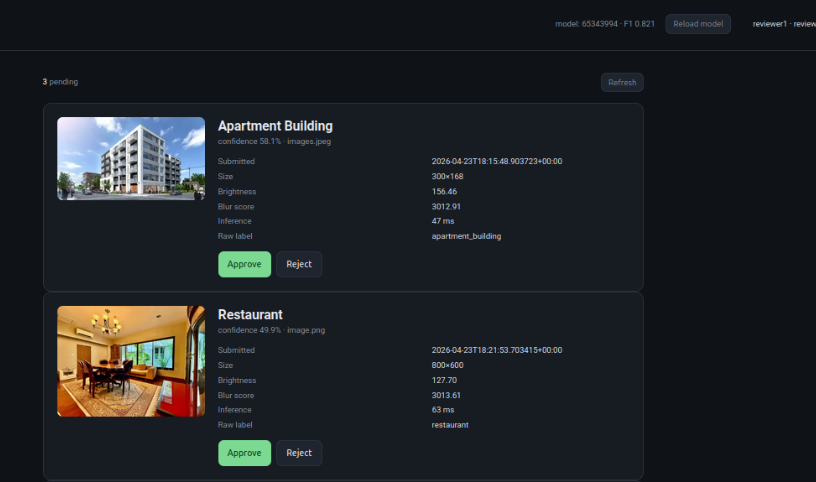
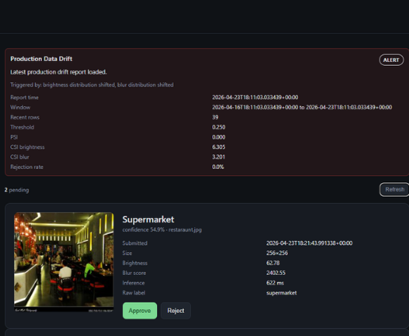
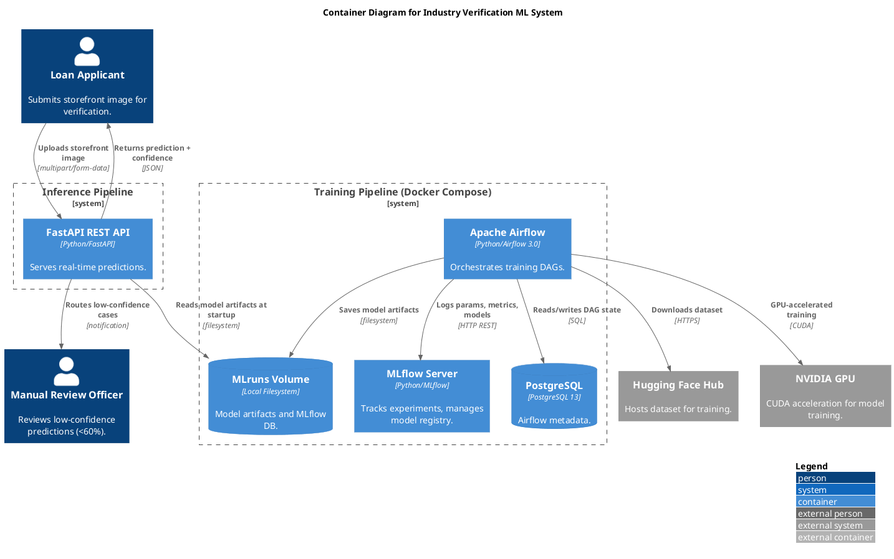

# SE for ML — Storefront Industry Classification

> Classify storefront images, route uncertain predictions for human review, and use production signals to decide when to retrain.

    

## What it does

This university group project explores the work around an image classifier, not just model training. A browser-facing FastAPI app classifies storefront photos into six industries, records predictions, and sends low-confidence cases to a reviewer. Separate Airflow workflows compare model candidates and monitor prediction data; MLflow records the experiments. When drift persists and the cooldown has passed, monitoring can trigger another training run using reviewed examples alongside the original dataset.

### Model comparison

The training workflow compares ResNet34 and EfficientNetV2-S feature extractors with PCA and logistic regression across two training splits. In the latest run, EfficientNetV2-S on the first training split came out top at ~0.82 test macro-F1, narrowly ahead of both ResNet34 configurations and the EfficientNetV2-S second split.

## Screenshots

| Upload & submit | Review queue | Drift detection |
| --- | --- | --- |
|  |  |  |
| Submit a storefront image; results flow to the reviewer queue when confidence drops below 60%. | Inspect pending predictions with image-quality diagnostics, then approve or correct each one. | When drift persists past the cooldown, monitoring flags PSI / brightness / blur shifts above the review queue. |

## Architecture

The training DAG is started manually. The daily drift DAG checks class distribution, image-quality signals, and reviewer rejection rate; persistent drift plus a cooldown gate can start the training DAG. Inference runs as a separate host process and reads model artifacts from the shared project directory.

## Why we built it

We built this as a university group project to practise the lifecycle of a machine-learning system beyond a notebook: serving predictions, observing incoming data, reviewing uncertain outcomes, tracking experiments, and deciding when new data warrants retraining. The aim was hands-on experience connecting those parts into a working pipeline, rather than claiming a production deployment.

## Engineering choices

- **Human review for uncertainty:** predictions below 60% confidence are marked for review; approved or corrected examples can feed later training runs.
- **Compare before promoting:** the training DAG evaluates candidate feature extractors and records test metrics in MLflow before writing a pointer to the selected model artifacts.
- **Avoid reactive retraining:** drift checks use PSI for class distribution, CSI for brightness and blur, and a reviewer rejection-rate signal. Minimum sample counts, persistence, and a cooldown limit noisy triggers.
- **Separate inference from orchestration:** FastAPI serves predictions while Airflow manages training and monitoring; the API reads the current model pointer on startup or an authorized reload.

## Tech stack

| Layer | Tools |
| --- | --- |
| Inference | PyTorch, torchvision, scikit-learn, FastAPI |
| Orchestration and experiments | Apache Airflow, MLflow |
| Persistence | PostgreSQL for prediction and review data; local model-artifact volume |
| Development and runtime | Python, Docker Compose, uv |

## API endpoints

| Method | Path | Purpose |
| --- | --- | --- |
| POST | `/api/v1/predict` | Submit an image; returns predicted industry, confidence, and whether it was routed to manual review |
| GET | `/api/v1/review/pending` | List low-confidence predictions awaiting human review |
| POST | `/api/v1/review/{id}` | Approve or reject a pending review, optionally with a corrected label |
| GET | `/api/v1/monitoring/drift/latest` | Latest drift report (PSI / brightness CSI / blur CSI / rejection rate) |
| POST | `/api/v1/admin/reload` | Hot-reload the model artifact from the shared volume without restarting the API |
| GET | `/health` | Liveness probe with current model and device info |

Web UI pages (`/login.html`, `/index.html`, `/review.html`) sit on top of these endpoints and gate access by role.

## Run locally

1. Install Docker with Compose and `uv`; use Python 3.14 or newer for the host app, as specified in `pyproject.toml`.
2. From the repository root, start the pipeline services: `docker compose -f airflow_pipeline/docker-compose.yml up -d --build`. The Compose file requests an NVIDIA GPU; without one, remove the GPU device reservation in that file first.
3. From the repository root, start the API: `uv run uvicorn api.main:app --host 127.0.0.1 --port 8000`. The first run may download pretrained model weights; the API also expects the model artifacts under `airflow_pipeline/mlruns/`.
4. Visit `http://127.0.0.1:8000/login.html`. A configured user account is required to submit images, and a reviewer account is required for the review dashboard. Airflow and MLflow are exposed at `http://localhost:8080` and `http://localhost:5000` respectively.

To run training, trigger `model_training_pipeline` in Airflow. The `drift_detection_pipeline` DAG is scheduled daily. See `api/main.py` for API routes and `airflow_pipeline/dags/` for the workflow definitions.
